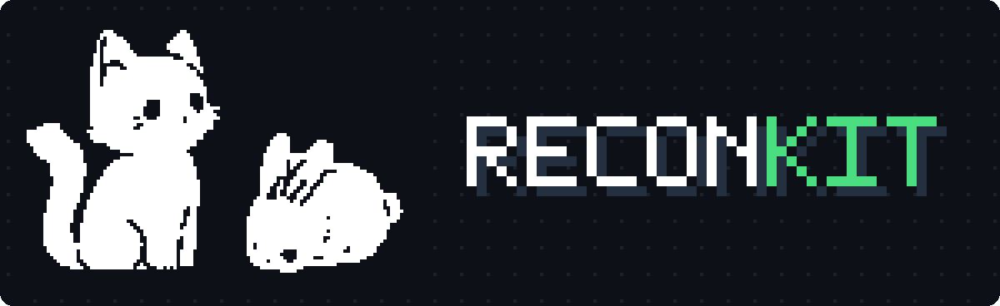
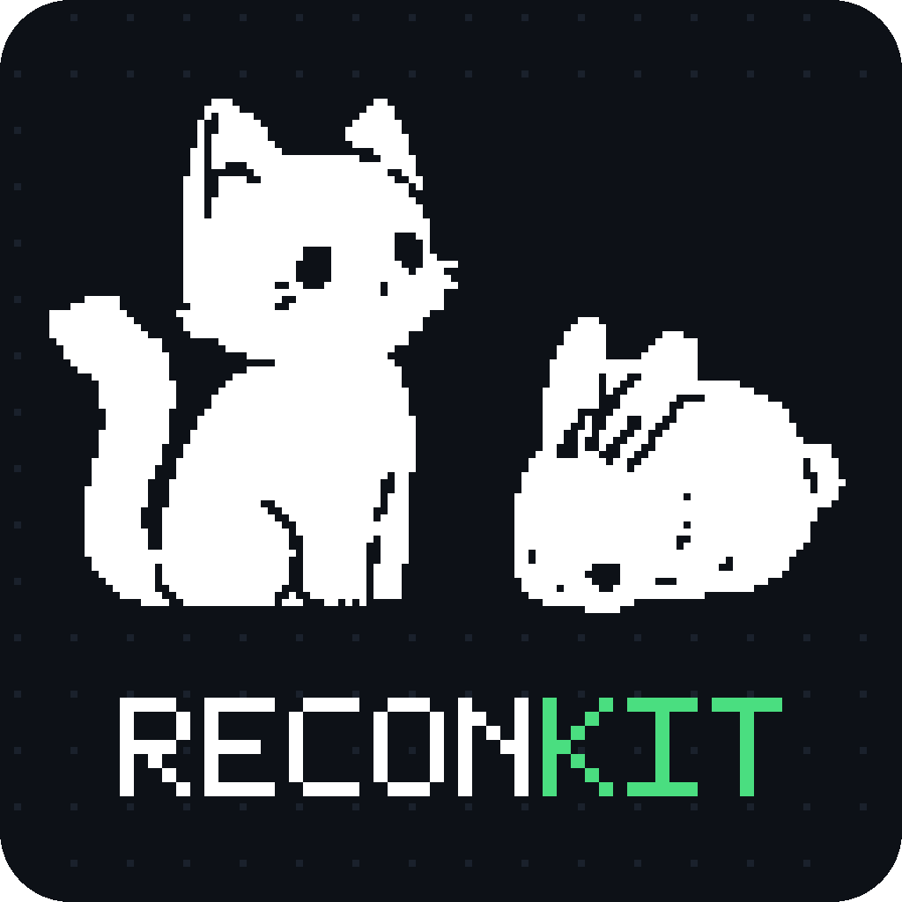

<p align="center">
  <br>
  <a href="https://github.com/elcnqlyv/reconkit" target="_blank"></a>
  <br>
  <br>
  <span>External and internal reconnaissance in one CLI. Passive, scope, then active. <b>Leads, not verdicts</b>.</span>
  <br>
</p>

<p align="center">
  <a href="#install">Install</a>
  &nbsp;&nbsp;&nbsp;•&nbsp;&nbsp;&nbsp;
  <a href="#workflow">Workflow</a>
  &nbsp;&nbsp;&nbsp;•&nbsp;&nbsp;&nbsp;
  <a href="#internal-mode-post-foothold">Internal mode</a>
  &nbsp;&nbsp;&nbsp;•&nbsp;&nbsp;&nbsp;
  <a href="#output-layout">Output</a>
  &nbsp;&nbsp;&nbsp;•&nbsp;&nbsp;&nbsp;
  <a href="#license">License</a>
</p>

```console
$ python3 recon.py
⠀⠀⠀⠀⠀⠀⠀⠀⠀⠀⠀⣠⣤⡀⠀⠀⠀⠀⠀⠀⠀⠀⢀⣤⡀
⠀⠀⠀⠀⠀⠀⠀⠀⠀⠀⢰⢁⣿⣿⣷⡄⠀⠀⠀⠀⠀⣴⣿⣿⣷⡀
⠀⠀⠀⠀⠀⠀⠀⠀⠀⠀⣾⢸⡿⠿⣿⣿⣦⣤⣤⣤⣤⣬⣉⣻⣿⣧
⠀⠀⠀⠀⠀⠀⠀⠀⠀⢰⣿⠀⣶⣶⣬⣿⣿⣿⣿⣿⣿⣿⣿⣿⣦⡝⠆
⠀⠀⠀⠀⠀⠀⠀⠀⠀⢸⣿⣸⣿⣿⣿⣿⣿⣿⣿⣿⣿⣿⣿⣿⣿⣿⣆
⠀⠀⠀⠀⠀⠀⠀⠀⠀⢸⣿⣿⣿⣿⣿⣿⣿⣿⠿⠿⣿⣿⣿⣿⡏⠉⢻
⠀⠀⠀⠀⠀⠀⠀⠀⠀⢸⣿⣿⣿⣿⣿⣿⣿⡏⠀⠀⣿⣿⣿⣿⣷⣄⣼⣷⡒
⠀⢀⣠⣤⣤⠀⠀⠀⠀⠸⣿⣿⣿⣿⣿⣿⠖⣻⣶⣾⣿⣿⣿⣧⣿⣿⣿⣿⠉
⣿⣿⣿⣿⣿⣷⣄⠀⠀⠹⣿⣿⣿⣿⣿⣿⣿⣿⣿⣿⣿⣿⣿⣿⣿⡿⠏⠀⠀⠀⠀⠀⠀⠀⠀⠀⢀⡴⢲⡄⠀⠀⠀⢀⣀
⠈⢿⣿⣿⣿⣿⣿⣿⡄⠀⠀⠀⠙⠛⠿⠿⣿⣿⣿⣿⣿⣿⣿⣿⡋⠁⠀⠀⠀⠀⠀⠀⠀⠀⠀⢀⡞⠀⠀⡇⠀⢀⡴⠋⠁⢸
⠀⠀⠉⢻⣿⣿⣿⣿⣧⠀⠀⠀⣠⣶⣿⣿⣿⣿⣿⣿⣿⣿⣿⣿⣿⡀⠀⠀⠀⠀⠀⠀⠀⠀⠀⣸⠁⠀⠀⡇⣠⠟⠀⠀⠀⣼⣠⣤⣤⣀
⠀⠀⠀⠘⣿⣿⣿⣿⡟⠀⢀⣼⣿⣿⣿⣿⣿⣿⣿⣿⣿⣿⣿⣿⣿⣇⠀⠀⠀⠀⠀⠀⠀⠀⠀⣿⠀⢠⢤⡿⠃⣀⠀⢀⡞⠉⠁⠀⠀⠈⠙⠶⡄
⠀⠀⠀⢰⣿⣿⣿⣿⠇⢀⣾⣿⣿⣿⣿⣿⣿⣿⣿⣿⣿⣿⣿⣿⣿⣿⠀⠀⠀⠀⠀⠀⠀⠀⠀⣻⣰⡏⣼⢁⡴⠋⣰⠋⠀⠀⠀⠀⠀⠀⠀⠀⠹⡄⣀⡀
⠀⠀⠀⣾⣿⣿⣿⡟⠀⣾⣿⣿⣿⣿⣿⣿⣿⣿⣿⣿⣿⣿⣿⣿⢿⡿⠀⠀⠀⠀⠀⠀⠀⢀⡾⠋⠉⠁⠀⠙⠁⠞⠁⠀⠀⠀⠀⠀⠀⠀⠀⠀⠀⢹⡈⢷
⠀⠀⢰⣿⣿⣿⣿⠀⢸⣿⣿⣿⣿⣿⣿⠿⣿⣿⣿⣿⣿⣿⣿⡇⣼⡇⠀⠀⠀⠀⠀⠀⠀⣼⠁⠀⠀⠀⠀⠀⠀⠀⠀⠀⠀⠄⠀⠀⠀⠀⠀⠀⠀⢀⣧⡾⠁
⠀⠀⢸⣿⣿⣿⣇⠀⣿⣿⣿⣿⣿⣿⣿⣷⣌⢻⣿⣿⣿⣿⣿⣴⣿⡇⠀⠀⠀⠀⠀⠀⠀⡏⠀⠀⠀⠀⠀⠀⠀⠀⠀⠀⠀⠄⠀⠀⠀⠀⠀⠀⠀⣾⠃
⠀⠀⠸⣿⣿⣿⣿⣤⣿⣿⣿⣿⣿⣿⣿⣿⣿⠄⣿⣿⣿⣿⡏⢸⣿⡇⠀⠀⠀⠀⠀⠀⠀⣹⡄⠀⠀⠀⠀⠀⠀⠀⠀⠀⠘⠁⠀⠀⡀⠀⠀⢰⡾⠋
⠀⠀⠀⠙⢿⣿⣿⡇⢿⣿⣿⣿⣿⣿⣿⣿⡿⠀⣿⣿⣿⣿⡇⣿⣿⠀⠀⠀⠀⠀⠀⠀⠀⢻⡇⣀⡀⠀⠺⣿⠇⠀⣀⣤⣄⣀⣠⣬⣥⣤⠾⠛⠁
⠀⠀⠀⠀⠀⠉⠙⠛⠂⠙⠛⠛⠛⠛⠛⠛⠐⠓⠈⠙⠋⠋⠃⠉⠉⠀⠀⠀⠀⠀⠀⠀⠀⠀⠉⠛⠓⠂⠤⠤⠖⠊⠉⠉⠉⠉⠁

                     _   _ _
 _ _ ___ __ ___ _ _ | |_(_) |_
| '_/ -_) _/ _ \ ' \| / / |  _|
|_| \___\__\___/_||_|_\_\_|\__|

  reconkit · combined external + internal recon orchestrator
  authorized testing only · leads, not verdicts · every command logged
```

One command-line tool combines two pentest cheat sheets into one workflow:

- **External and public-target recon** (domain and IP): passive, then scope, then active
- **Internal network discovery** (post-foothold)
- **Content and directory discovery** (native fuzzer, or `ffuf` / `gobuster`)
- **OSINT harvest** (`theHarvester`, or a native stdlib fallback)
- **Lead triage and report note**: it shows the main point to elaborate

reconkit uses the Python 3 standard library only. It calls external binaries
(`dig`, `nmap`, `nc`, `curl`, `openssl`, `whois`, `ffuf`, `gobuster`,
`subfinder`, `theHarvester`) when they are present. It still runs when they are
absent.

> [!WARNING]
> **Authorized testing only.** The active phases do not run without a scope
> allowlist and your confirmed authorization. A subdomain that resolves, or a
> shared IP, is **not** in scope by default. reconkit logs every external
> command to `evidence/commands.log` with the UTC time, the exact argv, the
> output file, and the exit code.

## Install

```bash
git clone https://github.com/elcnqlyv/reconkit.git
cd reconkit
./install.sh          # = python3 recon.py deps : checks your OS and offers to install tools
```

`deps` detects the platform (Arch/Omarchy, Debian/Ubuntu/**Kali**, Fedora,
macOS). It lists the required and optional tools that are missing. Then it
asks: **[I]nstall for me / [P]rint commands, I'll do it / [S]kip**. It never
installs without your consent. It runs repo installs with the terminal
attached, so you see the sudo and yay prompts. It runs AUR installs as your
user, never as `sudo yay`.

```bash
python3 recon.py deps              # interactive check + install
python3 recon.py deps --check      # report only, never install
python3 recon.py deps --print      # print the commands for you to run
```

reconkit needs only Python 3 and the core CLI tools
(`dig nmap nc curl openssl whois ip ss`). The tools `ffuf`, `gobuster`,
`subfinder`, `theHarvester`, and SecLists are optional. Native fallbacks run
without them.

| Platform | Install |
| --- | --- |
| **Kali** (intended runtime) | `sudo apt-get install -y nmap ffuf gobuster seclists theharvester dnsutils netcat-openbsd whois` |
| **Arch / Omarchy** | `gobuster` from the repo. `ffuf-bin` / `subfinder-bin` / `seclists-git` from the AUR |
| **subfinder** (any) | `go install github.com/projectdiscovery/subfinder/v2/cmd/subfinder@latest` |
| **theHarvester on Arch** | AUR build currently fails against `flit_core` 4. Use `sudo pacman -S python-pipx && pipx install theHarvester` |

## Commands

```console
$ python3 recon.py --help
usage: recon.py [-h]
                {shell,init,passive,harvest,deps,scope,active,content,internal,analyze,report,all} ...

Combined external + internal reconnaissance orchestrator (authorized testing only).

    shell      interactive mode: banner + prompt (default with no args)
    init       create a case + folder structure + scope file
    passive    passive discovery (crt.sh, wayback, dig, whois)
    harvest    OSINT harvest: emails/hosts (theHarvester or native)
    deps       check OS + install required/optional tools (with consent)
    scope      print/triage the scope table from passive results
    active     active checks on one approved target (nmap/curl/openssl)
    content    directory/content discovery (native, or ffuf/gobuster)
    internal   internal network discovery (local + optional probe)
    analyze    turn results into ranked leads
    report     write the report note (section 8 template + leads)
    all        init+passive+scope (+active/analyze/report if authorized)
```

## Interactive shell

Run `recon.py` with no arguments, or run `recon.py shell`, to start an
interactive prompt. It draws the banner. You then type the commands directly,
like `init example.com --host www.example.com`, then `passive`, then `scope`.
You do not retype `python3 recon.py` each time. All commands share the current
case, the same as the plain CLI. `help` lists the commands. `help <command>`
shows the options for a command. `exit` or Ctrl-D quits.

## Workflow

Each phase feeds the next. An authorization gate guards the active side of the
pipeline. The gate does not open for a hostname that only resolves.

```text
   ┌── passive ──┬── harvest ──┬── scope ──┐
   │  crt.sh     │  emails     │  triage   │
   │  wayback    │  hosts      │  leads    │
   │  dig·whois  │             │           │
   └─────────────┴─────────────┴───────────┘
                                     │
                       ╔═════════════▼═════════════╗
                       ║     AUTHORIZATION  GATE   ║
                       ║  written consent required ║
                       ║  scope.json → "true"      ║
                       ╚═════════════╤═════════════╝
                                     │
   ┌── active ───┬── content ──┬── analyze ─┬── report ──┐
   │  nmap       │  dir/file   │  rank      │  section-8  │
   │  curl·tls   │  fuzzing    │  leads     │  note        │
   └─────────────┴─────────────┴────────────┴─────────────┘
```

The same commands work non-interactively:

```bash
cd reconkit

# 1. open a case + folder structure + scope file
python3 recon.py init example.com --host www.example.com

# 2. passive discovery (crt.sh, Wayback, dig records, whois)
python3 recon.py passive

# 3. OSINT emails/hosts
python3 recon.py harvest

# 4. triage leads into an approved target list
python3 recon.py scope

#    >>> confirm written authorization, then edit the case's scope.json:
#        "authorized": true   (and list the exact hosts/IPs/CIDRs)

# 5. active checks on ONE approved target
python3 recon.py active --target www.example.com

# 6. content / directory discovery
python3 recon.py content --url https://www.example.com/ --ext php,bak,zip

# 7. rank findings into leads + pick the point to elaborate
python3 recon.py analyze

# 8. write the report note (cheat-sheet section 8 template + leads)
python3 recon.py report
```

The command `python3 recon.py all example.com --host www.example.com` chains
init, passive, harvest, and scope. It continues into active, analyze, and
report only when you mark the scope as authorized.

## Internal mode (post-foothold)

```text
   foothold ──▶ local clues ──▶ [--authorized] ──▶ subnet sweep
   (LOCAL)      ip·route·ss       role presets        nmap probe
                resolvectl        linux web           --confirm-sweep
                                  windows dc db
```

```bash
python3 recon.py internal                              # local clues only (LOCAL)
python3 recon.py internal --ip 10.0.0.5 --role windows --authorized
python3 recon.py internal --domain corp.local --dns 10.0.0.1   # AD DC SRV lookup
python3 recon.py internal --sweep 10.0.0.0/28 --authorized --confirm-sweep
```

Role presets (`--role`): `linux` `web` `windows` `dc` `db`.

## Output layout

```text
recon/<target>/<UTC-stamp>/
├── passive/    whois, dig_*, crtsh.json, wayback.txt, subdomains.txt,
│               resolved.txt, emails.txt, indexes.json
├── active/     nmap top100/versions/banners (.nmap/.xml/.gnmap),
│               headers.txt, tls-cert.txt
├── content/    dirscan.txt
├── internal/   ip-addr/route/neigh, resolvectl, ss-*, nmap-*
├── evidence/   start-utc.txt, commands.log   ◀─ every command, reproducible
└── report/     scope-table.md, recon-note-<target>.md
    scope.json  case.json  *_summary.json  leads.json
```

## Design notes / limits

- **Leads, not verdicts.** reconkit labels a banner or version string as
  *"possible / needs validation"*. It never runs exploit checks, credential
  attempts, or `vuln` NSE categories.
- **Soft-404 calibration.** The content fuzzer probes random paths first. It
  filters catch-all 200 responses, so a wildcard server does not fill the
  report with false hits. The fuzzer does not follow redirects. It reports 301,
  302, 401, and 403.
- **Ranking.** reconkit orders leads RCE-adjacent first, then by severity, then
  by confidence. `analyze` prints the one primary point to elaborate.
- reconkit keeps IPv4 and IPv6 separate. It records which address it contacted.
- Explicit flags guard `-p-`, `-O`, `-sU`, and subnet sweeps. reconkit calls
  `sudo` (as `sudo -n`) only for `-O` and `-sU`. It never calls `sudo` anywhere
  else.

## License

GPL-3.0-or-later. Copyright (C) 2026 Elchin Guliyev. See [LICENSE](LICENSE).

For authorized security testing only. You must have written permission before
you run any active phase against a target that you do not own.

<p align="center">
  <br>
  
  <br>
  <sub><b>recon</b><span>kit</span> · authorized testing only · leads, not verdicts</sub>
</p>
